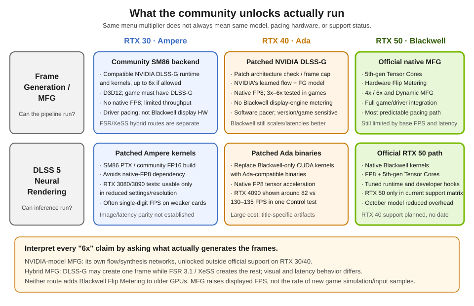

# NVIDIA's Neural Rendering Stack: What Ships, What Is Announced, and Where It Is Heading

A technical article, with original figures and reproducible scripts, on NVIDIA's neural rendering stack as of October 2026. It covers DLSS Super Resolution, Ray Reconstruction, Frame Generation and Multi Frame Generation, NVIDIA Reflex 2, and DLSS 5 (3D-Guided Neural Rendering). It also explains how games wire these models through Streamline and NGX, and why community injectors collide with them.

> **Read the article:** [`post.md`](post.md) · **Hardware deep dive:** [`hardware-architecture.md`](hardware-architecture.md)

---

## Status at a Glance (22 October 2026)

| Technology | Official support | Community status / caveat |
|---|---|---|
| **Super Resolution**, 2nd-gen Transformer (DLSS 4.5) | Shipping on all GeForce RTX | RTX 20/30 lack native FP8; Preset M/L can cost more than K |
| **Ray Reconstruction**, 2nd-gen Transformer | Shipping on all GeForce RTX | Preset F; +35% compute and +20% parameters vs prior model (NVIDIA) |
| **Frame Generation** (2x) | Shipping on RTX 40/50 | RTX 30/20 DLSS-G backends exist, but are community ports with API/runtime constraints |
| **Multi Frame Generation**, 3x–6x | RTX 50 only officially | NVIDIA-model DLSS-G unlocks tested on RTX 40 and ports on RTX 30; hybrid FSR/XeSS routes also exist |
| **Dynamic MFG and 6x** | NVIDIA app rollout for RTX 50 | Community unlockers expose higher multipliers where game/runtime allows; pacing is not Blackwell Flip Metering |
| **Reflex 1** | Shipping on GeForce GTX 900 and newer | Injector-based latency emulation is not the same as engine-integrated Reflex |
| **Reflex 2**, Frame Warp | Announced; not shipping | NVIDIA page still says "coming soon" |
| **DLSS 5**, 3D-Guided Neural Rendering | Shipping on RTX 50; RTX 40 expansion planned | Community builds demonstrated on RTX 40/30, including FP16 fallback on Ampere; results vary widely |

---

## Figures

All figures are original SVG diagrams or schematic animations generated from this repository. The GIFs are schematics, not captures from games.

### Pipeline and temporal reconstruction

**Engine frame pipeline** (`figures/fig1-pipeline.svg`)


**Sub-pixel jitter accumulation** (`figures/fig2-jitter.svg`)


**Motion-vector reprojection** (`figures/fig3-motion-vectors.svg`)


**Animated: jitter accumulation** (`figures/anim-jitter-accumulation.gif`)


### Frame generation and the HUD

**2x, 4x, and 6x frame timelines** (`figures/fig4-frame-generation.svg`)


**Hudless buffer and UI recomposition** (`figures/fig5-hudless.svg`)


**Animated: frame pacing across 1x, 2x, 4x, and 6x** (`figures/anim-mfg-pacing.gif`)


### Latency: Reflex 2 (announced, not shipping)

**Reflex 2 Frame Warp and predictive inpainting** (`figures/fig7-reflex2-frame-warp.svg`)


**Animated: Frame Warp walkthrough** (`figures/anim-reflex2-frame-warp.gif`)


### DLSS 5 and community injectors

**DLSS 5 3D-Guided Neural Rendering** (`figures/fig8-dlss5-neural-rendering.svg`)


**Proxy-DLL stacking and injector conflicts** (`figures/fig6-injector-stack.svg`)


---

## Hardware and Architecture

The companion article [`hardware-architecture.md`](hardware-architecture.md) covers the hardware in detail.

**SM layout across Ampere, Ada, and Blackwell** (`figures/fig9-sm-generations.svg`)


**Tensor core precisions by generation** (`figures/fig10-tensor-precision.svg`)


**Optical flow: hardware OFA versus AI flow** (`figures/fig11-ofa-pipeline.svg`)


**Multi Frame Generation: the network split** (`figures/fig12-mfg-split.svg`)


**Frame pacing: CPU pacing versus Flip Metering** (`figures/fig13-flip-metering.svg`)


**Model architectures by generation** (`figures/fig14-model-architectures.svg`)


**Community routes on RTX 30/40/50** (`figures/fig15-community-routes.svg`)



The important distinction is whether the mod keeps NVIDIA's DLSS-G model or swaps in FSR/XeSS for some generated frames. The former still lacks Blackwell's hardware Flip Metering on older cards; the latter is a hybrid path, not native DLSS MFG.

## Repository Layout

```text
.
├── post.md                              # The article (Markdown)
├── hardware-architecture.md             # Hardware and model architecture deep dive
├── README.md                            # This file
├── figures/
│   ├── fig1-pipeline.svg                # §1  Engine frame pipeline
│   ├── fig2-jitter.svg                  # §3  Sub-pixel jitter
│   ├── fig3-motion-vectors.svg          # §3  Motion-vector reprojection
│   ├── fig4-frame-generation.svg        # §5  2x / 4x / 6x timelines
│   ├── fig5-hudless.svg                 # §5  Hudless UI recomposition
│   ├── fig6-injector-stack.svg          # §9  Proxy-DLL conflicts
│   ├── fig7-reflex2-frame-warp.svg      # §6  Reflex 2 (announced)
│   ├── fig8-dlss5-neural-rendering.svg  # §7  DLSS 5
│   ├── fig9-sm-generations.svg          # HW  SM layout, Ampere / Ada / Blackwell
│   ├── fig10-tensor-precision.svg       # HW  Tensor core precisions
│   ├── fig11-ofa-pipeline.svg           # HW  Optical Flow Accelerator vs AI flow
│   ├── fig12-mfg-split.svg              # HW  MFG network split
│   ├── fig13-flip-metering.svg          # HW  CPU pacing vs Flip Metering
│   ├── fig14-model-architectures.svg    # HW  Model architectures by generation
│   ├── fig15-community-routes.svg       # HW  Native unlocks vs hybrid routes
│   ├── anim-jitter-accumulation.gif     # §3  Schematic
│   ├── anim-mfg-pacing.gif              # §5  Schematic
│   └── anim-reflex2-frame-warp.gif      # §6  Schematic (announced feature)
├── scripts/
│   ├── generate-gifs.ps1                # Rebuilds the GIFs with built-in Windows .NET
│   └── render-figures.ps1               # Exports SVGs to PNG
└── .gitignore
```

---

## Reproducing the Figures

### Regenerate the GIFs

No external tools are needed. The script uses `System.Drawing` and WPF's `GifBitmapEncoder`, both included with Windows PowerShell:

```powershell
powershell -ExecutionPolicy Bypass -File scripts\generate-gifs.ps1
```

### Export PNGs from the SVGs

Some platforms, such as Medium, do not accept SVG. Install one converter:

| Tool | Install |
|---|---|
| rsvg-convert | MSYS2: `pacman -S mingw-w64-x86_64-librsvg` |
| Inkscape | `winget install --id Inkscape.Inkscape` |
| ImageMagick | `winget install --id ImageMagick.ImageMagick` |

Then run from the repository root:

```powershell
powershell -ExecutionPolicy Bypass -File scripts\render-figures.ps1
```

PNGs are written to `figures/png/`, which git ignores.

---

## Sources

Primary NVIDIA sources:

- **DLSS 5:** [GTC announcement (16 Mar 2026)](https://www.nvidia.com/en-us/geforce/news/dlss5-breakthrough-in-visual-fidelity-for-games/) · [October update (13 Oct 2026)](https://www.nvidia.com/en-us/geforce/news/dlss-5-faster-ai-model-hogwarts-legacy-rtx-spark-laptops/) · [ADLR paper (1 Sep 2026)](https://research.nvidia.com/labs/adlr/DLSS5/)
- **DLSS 4 and Multi Frame Generation:** [announcement (Jan 2025)](https://www.nvidia.com/en-us/geforce/news/dlss4-multi-frame-generation-ai-innovations/) · [ADLR](https://research.nvidia.com/labs/adlr/DLSS4/)
- **DLSS 4.5 Super Resolution:** [announcement (14 Jan 2026)](https://www.nvidia.com/en-us/geforce/news/dlss-4-5-super-resolution-available-now/)
- **DLSS 4.5 Ray Reconstruction:** [announcement (25 Aug 2026)](https://www.nvidia.com/en-us/geforce/news/gamescom-2026-dlss-4-5-ray-reconstruction-release-announcements-trailers/)
- **DLSS 4.5 Dynamic MFG and 6x:** [release (31 Mar 2026)](https://www.nvidia.com/en-us/geforce/news/dlss-4-5-dynamic-multi-frame-generation-6x-mode-released/)
- **Reflex 2 with Frame Warp:** [announcement (6 Jan 2025)](https://www.nvidia.com/en-us/geforce/news/reflex-2-even-lower-latency-gameplay-with-frame-warp/)
- **Support matrix:** [DLSS technologies page](https://www.nvidia.com/en-us/geforce/technologies/dlss/)
- **SDK:** [Streamline](https://github.com/NVIDIA-RTX/Streamline)

Community projects and independent testing (used with their own caveats in the article):

- [MFG Unlocker / RTX MFG Universal](https://github.com/dashdogy/MFG-Unlocker) — current release notes list RTX 30 and 40 unlock paths, but require a game/runtime with DLSS-G integration.
- [`mfg-unlock`](https://github.com/matiasLombo/mfg-unlock) — Ada architecture-gate and pacing patches, with measured frame-delivery caveats.
- [`dlssg_for_sm86`](https://github.com/sdli1995/dlssg_for_sm86) — compatible DLSS-G backend/runtime for RTX 30 SM86 and RTX 20 SM75; D3D12-focused.
- [`dlss-unlocked`](https://github.com/ShyVortex/dlss-unlocked) — bundles different generation paths; some RTX 20/30 routes use FSR 3.1, not NVIDIA's MFG model.
- [Tom's Hardware: RTX 40 MFG test](https://www.tomshardware.com/pc-components/gpus/we-tested-dlss-multi-frame-generation-on-rtx-40-series-gpus-new-mod-brings-rtx-50-series-exclusive-feature-to-older-cards-and-it-really-works) and [DLSS 5 modder interview](https://www.tomshardware.com/pc-components/gpus/meet-the-modders-porting-ringfenced-dlss-features-to-older-gpus-how-dlss-5-and-multi-frame-generation-were-unlocked-for-older-architectures).
- [TechPowerUp: DLSS 5 older-GPU experiments](https://www.techpowerup.com/review/nvidia-dlss-5-technical-preview/5.html) and [Tom's Hardware: Ampere results](https://www.tomshardware.com/pc-components/gpus/dlss-5-mod-brings-next-gen-tech-to-old-ampere-gpus-but-frame-rates-are-horrible-most-games-tank-to-single-digits-high-end-gpus-can-hit-up-to-40-fps-in-some-cases).

These are unofficial, version-sensitive projects. Community reports may involve leaked/proprietary runtimes, binary patches, proxy DLLs, or hybrid FSR/XeSS output. Treat benchmarks as specific to their test configuration. Do not use injected mods in anti-cheat multiplayer unless the publisher explicitly allows them, and avoid untrusted mirrors/installers.

Personal runtime observations (Cyberpunk 2077 and Crimson Desert on an RTX 4090) are labeled as such in the article. They are log-based and were not independently measured.

---

## Note on Images

The SVGs and GIFs in this repository are original. Do not add NVIDIA screenshots, logos, or marketing images unless you have confirmed their license. Use your own captures or a source with a clear license, such as Wikimedia Commons.

## License

Add a license before publishing if you want to control reuse.
