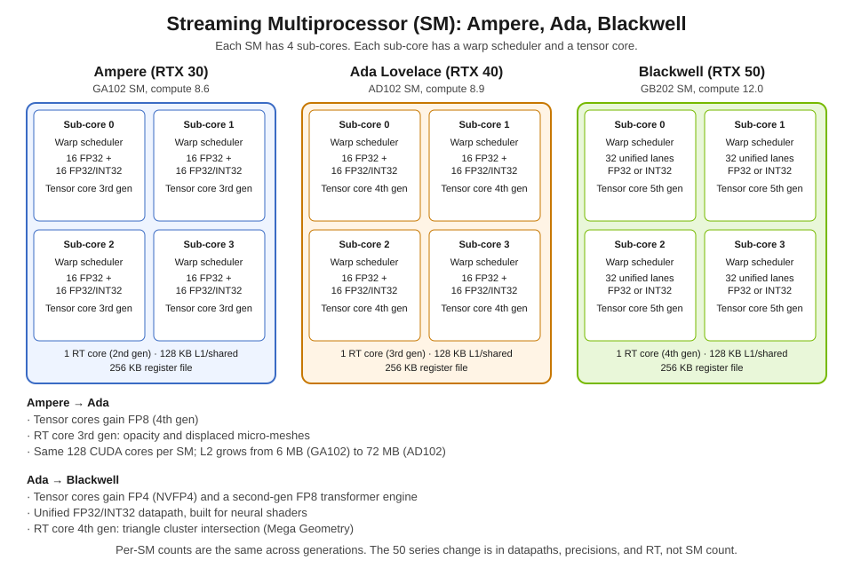
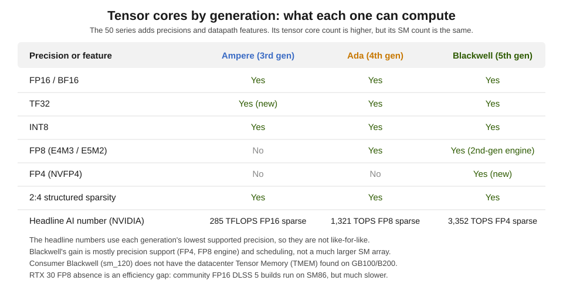
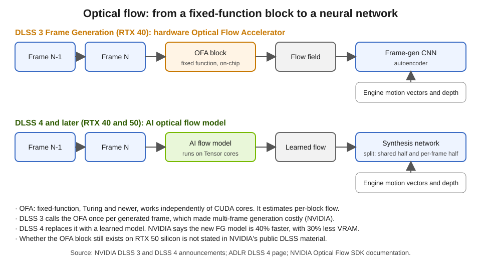
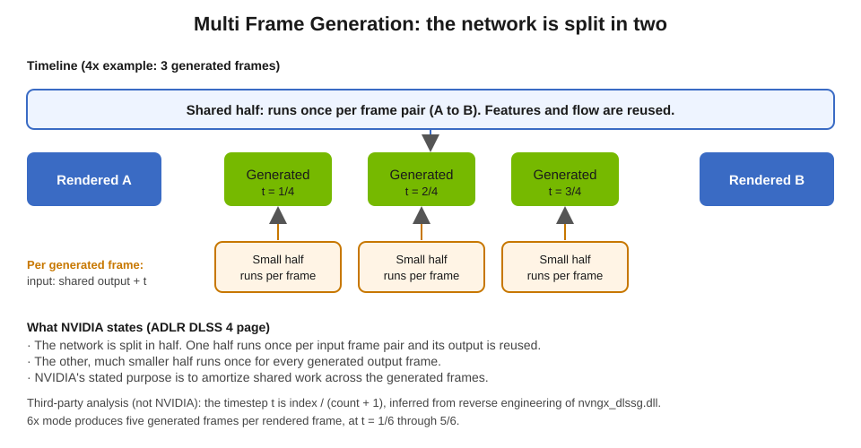
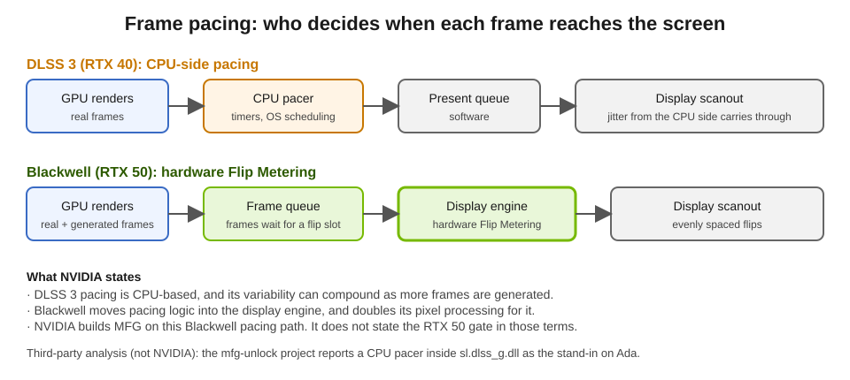
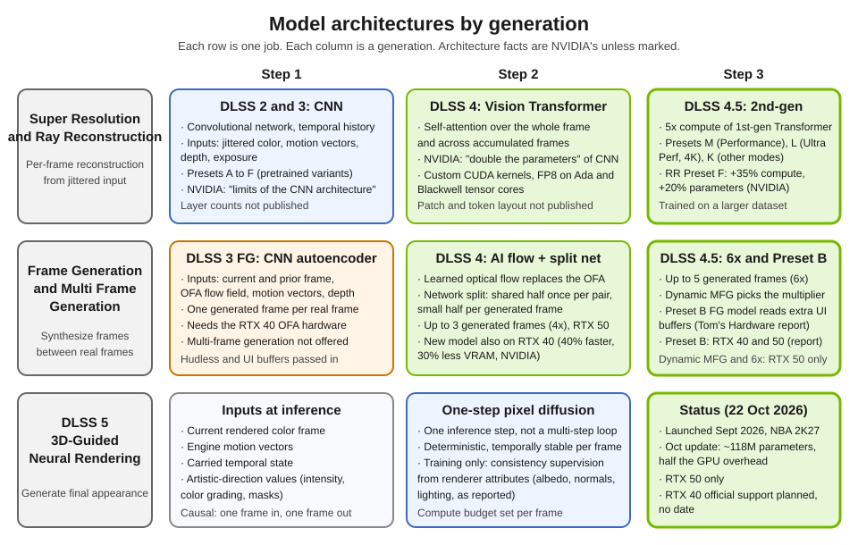

# Under the Hood: GeForce SMs, Tensor Cores, Optical Flow, and Multi Frame Generation

*Companion to [`post.md`](post.md). Status date: 22 October 2026. Each claim is marked as NVIDIA's statement, third-party analysis, or my inference. NVIDIA does not publish layer counts, token layouts, or parameter counts for most DLSS models, and this document says where that gap matters.*

---

## 1. Why the hardware matters

A DLSS pass is a neural network that has to finish inside a frame budget. At 240 Hz, a frame gets about 4.2 ms, and the GPU also has to render the game. Each generation of GeForce changes three things that decide whether a model fits that budget:

1. **How many tensor operations the SM can run per clock, and in which number formats.** Lower precision means more operations per second and less memory traffic.
2. **Fixed-function blocks that do work outside the SM.** The Optical Flow Accelerator and the display engine are the two that matter for DLSS.
3. **Scheduling and display pacing.** A generated frame that arrives late is worse than no generated frame at all.

---

## 2. The Streaming Multiprocessor, generation by generation

Every GeForce SM in these generations has the same outer structure: four sub-cores, each with a warp scheduler, a slice of the register file, and one tensor core. What changes is the per-sub-core datapath, the tensor core's precision support, and the RT core.

| Feature (per SM) | Ampere (GA102, RTX 30) | Ada (AD102, RTX 40) | Blackwell (GB202, RTX 50) |
|---|---|---|---|
| Compute capability | 8.6 | 8.9 | 12.0 |
| CUDA cores | 128 | 128 | 128 |
| Warp schedulers | 4 | 4 | 4 |
| Per sub-core datapath | 16 FP32 + 16 FP32/INT32 | 16 FP32 + 16 FP32/INT32 | 32 unified FP32 or INT32 |
| Tensor cores | 4, 3rd gen | 4, 4th gen | 4, 5th gen |
| RT cores | 1, 2nd gen | 1, 3rd gen | 1, 4th gen |
| Register file | 256 KB | 256 KB | 256 KB |
| L1 / shared memory | 128 KB | 128 KB | 128 KB |

The sub-core datapath row needs a note. The Ampere and Ada whitepapers describe each sub-core as 16 FP32-only lanes plus 16 lanes that run FP32 or INT32. Blackwell's whitepaper describes a unified datapath, where a sub-core runs either FP32 or INT32 in a given clock. NVIDIA says it designed this for neural shaders, where integer work handles address generation for small neural networks inside a shader.

### Card-level numbers

| Spec | RTX 3090 (GA102) | RTX 4090 (AD102) | RTX 5090 (GB202) |
|---|---|---|---|
| SMs | 82 | 128 | 170 |
| CUDA cores | 10,496 | 16,384 | 21,760 |
| Tensor cores | 328 | 512 | 680 |
| RT cores | 82 | 128 | 170 |
| L2 cache | 6 MB | 72 MB | 96 MB |
| Memory | 24 GB GDDR6X, 936 GB/s | 24 GB GDDR6X, 1,008 GB/s | 32 GB GDDR7, 1,792 GB/s |

These counts come from NVIDIA's spec pages and whitepapers, cross-checked with third-party reviews.

### What changed, generation by generation

- **Ampere to Ada:** the SM count per card rises, and L2 grows from 6 MB to 72 MB on the flagship dies. Tensor cores gain FP8. The RT core is 3rd gen, with opacity micromaps and displaced micro-meshes, which NVIDIA describes as ways to cut ray-tracing memory and work.
- **Ada to Blackwell:** tensor cores gain FP4 (NVFP4) and a second-generation FP8 transformer engine. The datapath is unified. The RT core is 4th gen, with a triangle cluster intersection engine for NVIDIA's Mega Geometry.

Per-SM counts barely change, so most of the RTX 50 throughput gain comes from more SMs, clocks, memory bandwidth, and the newer tensor core, not from a bigger SM.

---

## 3. Tensor cores and number formats

Tensor cores run matrix multiplies. The number format decides how many operations fit in one clock and how much memory each value takes.

- **FP16 and BF16** work on all three generations and are the base format for older DLSS models.
- **TF32** arrived with Ampere.
- **FP8** arrived with Ada. NVIDIA's ADLR DLSS 4 page says the Transformer models are trained and run in FP8 precision.
- **FP4 (NVFP4)** arrived with Blackwell. NVIDIA states it can "double AI throughput while halving memory requirements" compared with FP8, but DLSS has not been publicly documented as using FP4.
- **Structured sparsity (2:4)** has been in NVIDIA tensor cores since Ampere. It skips zeroed values in a weight matrix.

**Read the headline numbers carefully.** NVIDIA's "AI TOPS" figures use each generation's lowest precision and sparsity, so they are not comparable. RTX 3090 is 285 TFLOPS FP16 sparse. RTX 4090 is 1,321 TOPS FP8 sparse. RTX 5090 is 3,352 TOPS FP4 sparse. At matched precision the generational gain is much smaller.

### What RTX 20 and RTX 30 lack

RTX 20 and RTX 30 cards have no native FP8. NVIDIA says the 4.5 Transformer's M and L presets therefore cost more on those cards, and recommends Preset K there. This is a direct hardware limit on which DLSS presets are efficient.

---

## 4. Ray tracing cores (brief)

RT cores accelerate ray-triangle and ray-box tests. They matter for DLSS because Ray Reconstruction only needs to clean up as many rays as the RT cores can trace each frame.

- **2nd gen (Ampere):** about 2x Turing's ray-triangle rate, with hardware for motion blur.
- **3rd gen (Ada):** about 2x Ampere's ray-triangle rate, opacity micromaps, and displaced micro-meshes, which compress geometry for BVH building.
- **4th gen (Blackwell):** a triangle cluster intersection engine for Mega Geometry, which handles clusters of triangles together.

These are NVIDIA's claims from the launch material. I did not measure them.

---

## 5. The Optical Flow Accelerator

### 5.1 What it is

The Optical Flow Accelerator (OFA, also called NVOFA) is a fixed-function block that computes **dense optical flow** between two frames: for each block of pixels, a vector saying where that content moved. NVIDIA's Optical Flow SDK documentation says it runs independently of the CUDA cores. It has been present since Turing.

### 5.2 What the SDK exposes

From NVIDIA's Optical Flow SDK programming guide:

- **Input:** pairs of YUV or RGB frames.
- **Output:** flow vectors per block, at quarter-pixel precision. Block size is 4x4, 2x2, or 1x1 pixels. The 2x2 and 1x1 grids are Ampere and newer features.
- **Hints:** an external flow hint can be supplied, which lets an engine feed in its own motion vectors.
- **Cost output:** an optional per-vector cost, where a higher cost means the vector is less reliable.
- **Presets:** three quality/speed presets.
- **Frame-rate conversion:** NVIDIA also ships a FRUC library built on the same hardware.

NVIDIA's SDK page says the OFA is available on "Turing and newer." The SDK does not say whether a given consumer Blackwell card has the block, and I could not confirm that from NVIDIA's public material.

### 5.3 How DLSS 3 used it

DLSS 3 Frame Generation (RTX 40, September 2022) fed two consecutive rendered frames to the OFA. The OFA's flow field went into a convolutional autoencoder along with the current and prior frames, engine motion vectors, and depth. NVIDIA says the flow field captures "pixel-level information such as particles, reflections, shadows, and lighting" that engine motion vectors miss, while engine vectors stay more accurate for geometry.

### 5.4 Why DLSS 4 replaced it

NVIDIA's DLSS 4 announcement says the DLSS 3 approach made multi-frame generation "cost prohibitive," because the OFA and the AI model both ran for every generated frame. DLSS 4 replaced the OFA with "a very efficient AI model," and the new Frame Generation model runs once per rendered frame. NVIDIA says it is 40% faster and uses 30% less VRAM.

In a Digital Foundry interview, Bryan Catanzaro, NVIDIA's VP of applied deep learning research, explained the reasoning. Hardware optical flow is fixed: once built, it cannot be retrained. Its failures "couldn't be undone with a smarter neural network." A learned flow model can be trained together with the generation network, and it runs on the Tensor cores that are already there.

### 5.5 Where this leaves RTX 50

NVIDIA's public DLSS material does not say whether the OFA block remains on RTX 50 silicon. DLSS 4 does not use it. The hardware question is open, and I do not state it either way.

---

## 6. How Multi Frame Generation works

### 6.1 The split network

NVIDIA's ADLR DLSS 4 page describes the MFG architecture as follows:

> "The new DLSS Multi Frame Generation architecture splits the neural component of DLSS 3's Frame Generation in half. One half of the network runs once for every input frame pair and its output is then able to be re-used. The other (much smaller) half runs once for every generated output frame."

So for a 4x mode, the expensive half runs once for the pair of rendered frames (A and B). The small half then runs three times, once for each generated frame. Its output depends on the shared half's result and on a position in time.

### 6.2 Timing the generated frames

NVIDIA does not describe the timing input. A third-party reverse engineering of `nvngx_dlssg.dll` (the mfg-unlock project) reports that the interpolation position is `t = index / (count + 1)`. For 4x that gives t = 1/4, 2/4, and 3/4. For 6x it gives five positions, from 1/6 to 5/6. This matches NVIDIA's description, but it is not an NVIDIA disclosure.

### 6.3 Modes

| Mode | Generated frames per rendered frame | Hardware |
|---|---|---|
| 2x Frame Generation | 1 | RTX 40 and RTX 50 |
| 4x MFG (DLSS 4, Jan 2025) | up to 3 | RTX 50 |
| 6x MFG (DLSS 4.5) | up to 5 | RTX 50 |
| Dynamic MFG (DLSS 4.5) | changes between 1x and the 6x max | RTX 50 |

NVIDIA describes Dynamic MFG as adjusting the multiplier to reach a target frame rate or the display's maximum refresh rate. NVIDIA's own caveat is that Dynamic mode is not compatible with frame-rate limiters or V-Sync.

### 6.4 The workload

NVIDIA says the GPU runs "5 AI models across Super Resolution, Ray Reconstruction, and Multi Frame Generation for each rendered frame, all within a few milliseconds." It also gives a per-frame cost comparison from the ADLR page. DLSS 3 frame generation took about 3.25 ms per 4K frame on an RTX 4090. DLSS 4 MFG took about 1 ms per generated frame on an RTX 5090 at launch. These are different GPUs and different generations, so read them as a trend.

---

## 7. What Blackwell adds beyond the AI cores

Faster tensor cores explain part of the MFG result. NVIDIA also points to hardware that is not in the SM.

### 7.1 Flip Metering in the display engine

DLSS 3 paced generated frames on the CPU. NVIDIA says that pacing's variability "can compound with additional frames, leading to less consistent frame pacing." Blackwell moves the pacing logic into the **display engine**, which controls the timing of each flip (scanout). NVIDIA calls this hardware Flip Metering.

A third-party project (mfg-unlock) reports that on RTX 40 a CPU pacer inside `sl.dlss_g.dll` replaces the display-engine pacer, and that it produces visible "stacked frames" stutter. That is third-party analysis, not an NVIDIA statement. The open-source PresentMon project (GameTechDev) merged a pull request from an NVIDIA developer that adds driver events for Flip Metering, so measured flip intervals can reflect the display engine's timing. That is also third-party, from the public repository.

### 7.2 Display engine bandwidth

NVIDIA says the Blackwell display engine has "twice the pixel processing capability" to support Flip Metering at high resolution and refresh rate. This is a stated number, not a measured one.

### 7.3 Other blocks NVIDIA lists

NVIDIA's Blackwell architecture material also names:

- **AI Management Processor (AMP):** a scheduler for AI workloads that run alongside graphics. Third-party sources describe it as RISC-V based. I could not confirm that detail from NVIDIA.
- **Neural shader support:** NVIDIA's RTX Neural Shaders, cooperative vectors (a DirectX shader feature that exposes matrix operations to the Tensor cores), and the unified FP32/INT32 datapath.
- **Memory:** GDDR7 with PAM3 signaling.
- **Media:** a 9th-gen NVENC and 6th-gen NVDEC, as listed in the architecture material.

### 7.4 What RTX 40 gets, and what it cannot run

| | RTX 40 (Ada) | RTX 50 (Blackwell) |
|---|---|---|
| Transformer Super Resolution, Ray Reconstruction, DLAA | Yes (all RTX GPUs) | Yes |
| 2x Frame Generation with the new learned flow model | Yes | Yes |
| 4x and 6x MFG, Dynamic MFG | No (NVIDIA) | Yes |
| Hardware Flip Metering in the display engine | No (NVIDIA) | Yes |
| DLSS 5 neural rendering | No official support yet (NVIDIA plans it) | Yes |

Third-party work has found that RTX 40 can execute the MFG kernels (`nvngx_dlssg` includes sm_89 binaries), and that the RTX 50 gate looks like a software check on the GPU architecture ID. Those findings are unofficial and I have not tested them.

---

## 8. Model architectures

### 8.1 Super Resolution and Ray Reconstruction

**DLSS 2 and 3 (CNN).** A temporal convolutional network. Inputs are jittered low-resolution color, motion vectors, depth, and exposure. "Presets" A to F are pretrained variants of the same network, chosen per quality mode. NVIDIA later removed some of them and deprecated others, and says the CNN "reached the limits of what's possible." NVIDIA has not published the layer structure.

**DLSS 4 (vision Transformer).** NVIDIA says the model uses self-attention "to evaluate the relative importance of each pixel across the entire frame, and over multiple frames," with "double the parameters" of the CNN. NVIDIA's ADLR page says the transformer is written for NVIDIA's GPU architecture, with custom CUDA kernels that use on-chip memory and FP8. A third-party analysis of the Preset K kernel describes a U-shaped network with 8x8 windowed attention. NVIDIA has not confirmed that, so treat it as inference.

**DLSS 4.5 (second-generation Transformer).** NVIDIA says it uses five times the compute of the first-generation Transformer, and that it was trained on a larger dataset. It uses the engine's pixel sampling and motion data "more intelligently." It has presets M (Performance), L (Ultra Performance at 4K), and K (other modes). NVIDIA does not publish a parameter count.

**Ray Reconstruction.** RR takes the noisy ray-traced output along with the same G-buffer data (depth, normals, motion vectors) and fuses denoising with upscaling in one network. Preset F is the 2nd-gen RR model. NVIDIA says it has 35% more compute capability and 20% more parameters than the previous model, at similar performance.

### 8.2 Frame Generation

**DLSS 3 FG (CNN autoencoder).** Four inputs: the current frame, the prior frame, the OFA flow field, and engine motion vectors and depth. The output is one generated frame. The hudless color and UI buffers are passed in separately so the network can keep the HUD out of its output.

**DLSS 4 FG and MFG (learned flow plus split network).** The OFA is replaced by a learned optical-flow model. The synthesis network is split, as described in section 6. The new model runs on RTX 40 as well as RTX 50.

**DLSS 4.5 (Preset B).** A Frame Generation model that reads extra UI buffers from selected engines. Tom's Hardware reports that it runs on RTX 40 and RTX 50. I could not confirm that on NVIDIA's own pages, so treat it as reported.

### 8.3 DLSS 5

DLSS 5 is described in NVIDIA's ADLR paper as a one-step pixel-space diffusion model. Its inputs at inference are the rendered color frame, engine motion vectors, carried temporal state, and artistic-direction values. During training it also sees renderer-derived scene attributes that supervise the output to stay faithful to the authored scene. NVIDIA says it is deterministic and causal, and that it runs under a fixed per-frame compute budget.

NVIDIA's October 2026 update says the model is now about 118 million parameters, 24% smaller than before, with half the GPU overhead of the September version. Other reports put the earlier model at 148 to 155 million parameters, but those figures come from press calculations, not from NVIDIA.

---

## 9. What NVIDIA does not publish

- Layer counts, token sizes, and attention layouts for the SR and RR transformers.
- Whether the OFA block exists on RTX 50 silicon.
- The exact timestep conditioning used by MFG.
- The input color space DLSS expects before tonemapping (check the Streamline programming guide before writing engine code).
- Measured pacing results with Flip Metering on and off.

Where a claim depends on one of these, this document says so.

---

## 10. Sources

NVIDIA:

- Ampere GA102 whitepaper: https://www.nvidia.com/content/PDF/nvidia-ampere-ga-102-gpu-architecture-whitepaper-v2.pdf
- Ada Lovelace whitepaper: https://images.nvidia.com/aem-dam/Solutions/geforce/ada/nvidia-ada-gpu-architecture.pdf
- RTX Blackwell GPU architecture whitepaper: https://images.nvidia.com/aem-dam/Solutions/geforce/blackwell/nvidia-rtx-blackwell-gpu-architecture.pdf
- RTX 4090 and RTX 5090 spec pages: https://www.nvidia.com/en-us/geforce/graphics-cards/40-series/rtx-4090/ and https://www.nvidia.com/en-us/geforce/graphics-cards/50-series/rtx-5090/
- Optical Flow SDK programming guide: https://docs.nvidia.com/video-technologies/optical-flow-sdk/nvofa-programming-guide/index.html
- DLSS 3 announcement (Sept 2022): https://www.nvidia.com/en-us/geforce/news/dlss3-ai-powered-neural-graphics-innovations/
- DLSS 4 Multi Frame Generation (6 Jan 2025): https://www.nvidia.com/en-us/geforce/news/dlss4-multi-frame-generation-ai-innovations/
- ADLR DLSS 4: https://research.nvidia.com/labs/adlr/DLSS4/
- ADLR DLSS 5 (1 Sep 2026): https://research.nvidia.com/labs/adlr/DLSS5/
- DLSS 4.5 Super Resolution (14 Jan 2026): https://www.nvidia.com/en-us/geforce/news/dlss-4-5-super-resolution-available-now/
- DLSS 4.5 Ray Reconstruction (25 Aug 2026): https://www.nvidia.com/en-us/geforce/news/gamescom-2026-dlss-4-5-ray-reconstruction-release-announcements-trailers/
- DLSS 4.5 Dynamic MFG and 6x (31 Mar 2026): https://www.nvidia.com/en-us/geforce/news/dlss-4-5-dynamic-multi-frame-generation-6x-mode-released/
- DLSS 5 October update (13 Oct 2026): https://www.nvidia.com/en-us/geforce/news/dlss-5-faster-ai-model-hogwarts-legacy-rtx-spark-laptops/

Third-party, used only where noted:

- Digital Foundry, Bryan Catanzaro interview (CES 2025): https://www.digitalfoundry.net/articles/digitalfoundry-2025-bryan-catanzaro-interview-dlss-4-and-machine-learning
- mfg-unlock project (reverse engineering of `nvngx_dlssg.dll`): https://deepwiki.com/matiasLombo/mfg-unlock/3.2-multi-frame-generation-pipeline
- PresentMon pull request adding DLSS 4 flip-metering events: https://github.com/GameTechDev/PresentMon/pull/440
- Tom's Hardware, DLSS 4.5 Dynamic MFG and Preset B: https://www.tomshardware.com/pc-components/gpus/nvidia-dlss-4-5-dynamic-mfg-plus-5x-and-6x-framegen-modes-enter-beta-for-rtx-50-series-users-update-offers-greater-control-over-generated-frame-rates-and-more-headroom-for-high-refresh-rate-displays
