# Inside the Modern NVIDIA DLSS Stack: Super Resolution, Ray Reconstruction, Frame Generation, Reflex 2, and DLSS 5 Neural Rendering

*All architectural claims below are verified against NVIDIA primary announcements, research publications, and SDK documentation, with community compatibility work explicitly distinguished from official NVIDIA support.*

---

## 1. The Real-Time Rendering Budget and the DLSS Family

At 4K (`3840 × 2160` or ultrawide `7680 × 2160`), a game engine has to shade 8.3 to 16.6 million pixels every frame. Full path tracing and complex material shaders make shading every pixel at native resolution and maximum refresh rate prohibitively expensive. Modern neural graphics attacks that bottleneck across four distinct dimensions:

1. **Spatial-Temporal Reconstruction:** Render fewer pixels per frame and reconstruct native-resolution detail across time (**DLSS Super Resolution** and **DLAA**).
2. **Neural Denoising:** Trace fewer rays per pixel and replace hand-tuned denoisers with a unified spatio-temporal neural network (**DLSS Ray Reconstruction**).
3. **Temporal Frame Synthesis:** Render fewer full frames and synthesize intermediate frames (**DLSS Frame Generation** and **Multi Frame Generation**).
4. **Latency Warp & Neural Shading:** Warp rendered frames to the latest mouse input immediately before scanout (**NVIDIA Reflex 2**) and synthesize photorealistic lighting and material response from 3D engine buffers (**DLSS 5 Neural Rendering**).

| Technology | Core Question Answered | Key Runtime Binary | Official Hardware Support |
|---|---|---|---|
| **Super Resolution (SR) & DLAA** | Given a lower-resolution jittered frame and history, what does the full-resolution frame look like? | `nvngx_dlss.dll` | All GeForce RTX GPUs *(FP8 accelerated on RTX 40/50)* |
| **Ray Reconstruction (RR)** | Given sparse, noisy ray-traced radiance buffers and G-buffers, what is the clean, upscaled lighting? | `nvngx_dlssd.dll` | All GeForce RTX GPUs |
| **Frame Generation (FG)** | What does the scene look like halfway between two rendered frames? | `nvngx_dlssg.dll` | GeForce RTX 40 & RTX 50 Series |
| **Multi Frame Generation (MFG)** | How do we synthesize up to 3 (4x) or 5 (6x) intermediate frames per rendered frame with uniform pacing? | `nvngx_dlssg.dll` | GeForce RTX 50 Series *(Blackwell Tensor Cores + Flip Metering)* |
| **NVIDIA Reflex & Reflex 2** | How do we eliminate the GPU render queue and warp the finished frame to the newest camera input before scanout? | `sl.reflex.dll` / `nvngx_ratewarp.dll` | Reflex 1: GTX 900+ Reflex 2 Frame Warp: RTX 50 Series first; other RTX GPUs planned |
| **DLSS 5 Neural Rendering** | Given 3D engine buffers (color, motion vectors, depth, materials), how should photoreal lighting and materials look? | `nvngx_dlssnr.dll` | GeForce RTX 50 Series (& GeForce NOW; RTX 40 tuning planned) |

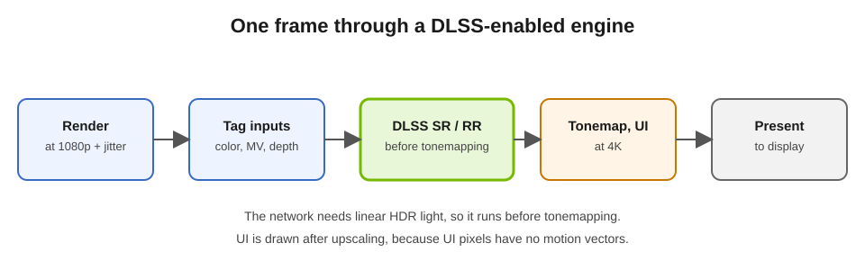

---

## 2. DLSS Super Resolution: From Temporal CNNs to 2nd-Gen Vision Transformers

DLSS Super Resolution does not upscale a single low-resolution image in isolation. Instead, it is a **temporal accumulator** driven by deep neural networks.

Every frame, the game engine renders the scene at a fraction of the target resolution (for example, `1920 × 1080` internal resolution for a `3840 × 2160` 4K output in Performance mode) and shifts the camera projection matrix by a sub-pixel offset (typically a Halton sequence) called **jitter**. Over consecutive frames, different sub-pixel locations of the high-resolution output grid are sampled.

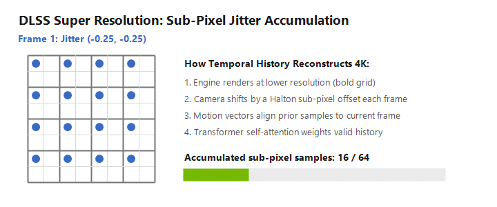

To combine these samples without smearing moving objects, the network consumes:

1. **Current low-resolution color** (in linear HDR space, prior to tonemapping).
2. **Recurrent history**: the previous high-resolution output frame.
3. **Per-pixel motion vectors (velocity buffer) and depth**: how far each surface moved in screen space between the previous frame and the current frame, plus exposure and camera jitter offsets.

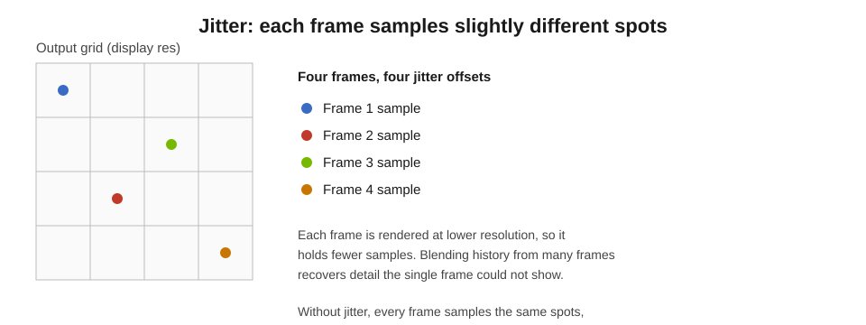

Using the engine's motion vectors, the network warps (reprojects) the previous high-resolution output to align with the current camera and object positions, then decides per pixel how much historical detail to keep and how much to reject due to disocclusion or lighting changes.

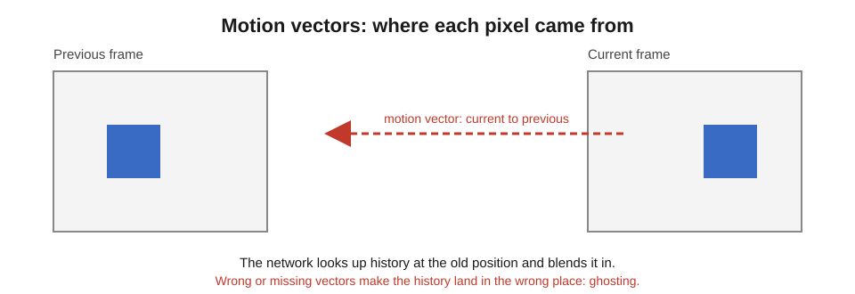

### Evolution of the Super Resolution Model

- **DLSS 1 (2018–2019):** Per-game convolutional autoencoders trained without engine motion vectors.
- **DLSS 2 & 3.x (2020–2024):** A generalized temporal Convolutional Neural Network (CNN) shared across games (`Presets A–F`). After six years of refinement, NVIDIA noted that the fixed local receptive fields of CNNs had reached an architectural ceiling on ghosting, shimmer, and fine motion detail.
- **DLSS 4 (January 2025, 1st-Gen Transformer):** Replaced the CNN with a real-time **Vision Transformer** (`Preset J` and refined `Preset K`) featuring **2× the parameters and 4× the compute** of the CNN. Self-attention mechanisms allow the model to evaluate pixel importance across a much wider spatial neighborhood and across multiple frames, substantially reducing ghosting on thin geometry, wires, and foliage.
- **DLSS 4.5 (January 2026, 2nd-Gen Transformer):** Expanded to **5× the compute of the first-generation Transformer**, accelerated via **FP8 precision** on RTX 40 and RTX 50 Tensor Cores. Crucially, DLSS 4.5 trains and runs inference directly in **linear HDR space** rather than compressed log space, preserving bright specular highlights and deep shadow gradation without muting contrast.

### Official DLSS 4.5 Super Resolution Presets

NVIDIA's "Recommended" profile maps presets dynamically based on the active quality mode:

- **Preset M:** 2nd-generation Transformer tuned specifically for **DLSS Performance** mode.
- **Preset L:** 2nd-generation Transformer tuned specifically for **4K DLSS Ultra Performance** mode.
- **Preset K:** Refined 1st-generation Transformer used for **Quality, Balanced, and DLAA** modes (and recommended on RTX 20/30 GPUs that lack native FP8 Tensor Core throughput).

---

## 3. DLSS Ray Reconstruction: Replacing Hand-Tuned Denoisers

Real-time path tracing and ray tracing can only afford 1 to 2 rays per pixel per effect, yielding a noisy "salt-and-pepper" raw radiance buffer. Historically, engines ran separate, hand-tuned spatio-temporal denoisers for global illumination, reflections, and shadows before passing the combined image to DLSS Super Resolution.

Those classical denoisers face an unavoidable trade-off:
- Accumulating across too many frames causes **ghosting trails** behind moving lights and reflections.
- Blurring spatially destroys fine normal-map detail, mesh fences, and contact shadows.
- Running three or four separate denoisers wastes memory bandwidth and discards raw surface context before upscaling.

**DLSS Ray Reconstruction** (`nvngx_dlssd.dll`), introduced in **DLSS 3.5** (August 2023), replaces the entire stack of hand-tuned denoisers and the Super Resolution pass with a **single unified neural network** trained on offline path-traced ground-truth reference frames (5× more training data than DLSS 3). It ingests noisy ray-traced radiance alongside G-buffer surface normals, roughness, albedo, depth, and motion vectors, performing **joint denoising and upscaling in one pass**.

In **DLSS 4** (January 2025), Ray Reconstruction moved to a Transformer architecture (`Preset D / J`). In **DLSS 4.5** (August/September 2026, SDK `310.9.1`), NVIDIA introduced a second-generation Transformer for Ray Reconstruction exposed as **Preset F**, delivering **35% more compute capability and 20% more parameters** alongside finer developer control over temporal accumulation and specular stability.

---

## 4. Frame Generation and Hudless UI Recomposition

While Super Resolution and Ray Reconstruction reconstruct pixels within a rendered frame, **DLSS Frame Generation** (`nvngx_dlssg.dll`) synthesizes entirely new intermediate frames between two rendered frames (`Real Frame N-1` and `Real Frame N`).

- **DLSS 3 Frame Generation (September 2022):** Relied on the dedicated hardware **Optical Flow Accelerator (OFA)** on GeForce RTX 40 Series GPUs to compute pixel-level optical flow (capturing motion such as moving shadows or reflections that geometry motion vectors miss), fused with engine motion vectors and depth inside a CNN autoencoder to emit one generated frame per rendered frame (**2x mode**).
- **DLSS 4 Frame Generation (January 2025):** Replaced the hardware OFA with an **AI optical-flow model** running on Tensor Cores. Compared to the DLSS 3 implementation, the DLSS 4 frame-generation network executes **40% faster and uses 30% less VRAM**, benefiting both RTX 50 and RTX 40 Series GPUs.

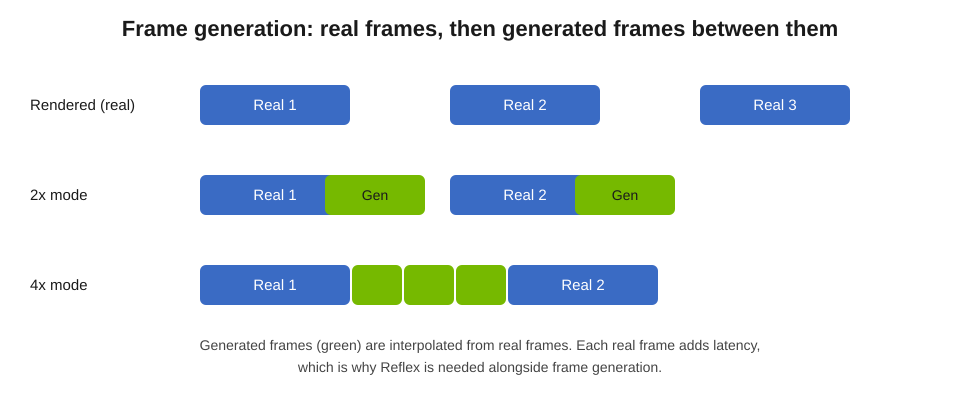

### Why Frame Generation Requires a Hudless Buffer

A game's HUD—crosshairs, health bars, minimaps, and subtitles—sits fixed in screen space or snaps instantaneously, meaning it has **no valid 3D motion vectors**. If Frame Generation interpolated the final composited backbuffer, every camera pan would tear and smear the UI across generated frames.

To prevent UI distortion, engines integrated via NVIDIA Streamline pass two additional resources at present time:
1. **Hudless Color Buffer:** The rendered 3D scene *before* any 2D interface is drawn.
2. **UI Color & Alpha Buffer:** The translucent HUD layer rendered at native output resolution.

The Frame Generation model interpolates only the **hudless scene**, and then composites the crisp UI buffer on top of each generated frame prior to display scanout.

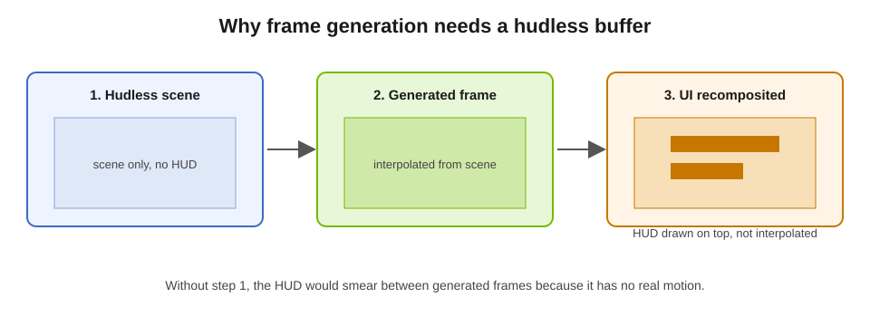

---

## 5. Multi Frame Generation (4x & Dynamic 6x) and Flip Metering

**Multi Frame Generation (MFG)** extends frame synthesis from one generated frame to multiple generated frames between each pair of rendered engine frames:

- **DLSS 4 MFG (4x Mode, January 2025):** Generates up to **3 intermediate frames** per rendered frame. To stay within a few milliseconds at 4K, NVIDIA split the neural architecture in two: the heavy optical-flow and feature-extraction half runs **once per rendered frame pair**, and a lightweight synthesis half runs once for each generated timestep (`t = 0.25, 0.50, 0.75`).
- **DLSS 4.5 Dynamic MFG & 6x Mode (CES January 2026 / Released March 2026):** Adds a **6x mode** generating up to **5 intermediate frames** per rendered frame (`t = 1/6 … 5/6`), plus **Dynamic Multi Frame Generation**, which acts like an automatic transmission—monitoring GPU frame time in real time and shifting the frame multiplier between `1x` and `6x` to lock output to the display's maximum refresh rate (e.g., 144 Hz or 240 Hz) without over-generating frames.

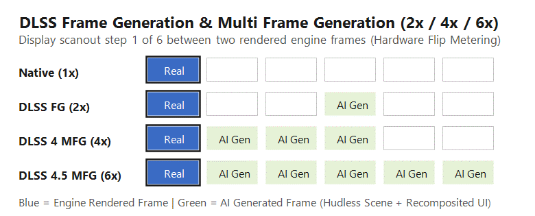

### Hardware Flip Metering

Generating 3 to 5 frames per rendered frame makes **frame pacing** critical: if generated frames arrive at uneven intervals, a 200 FPS output feels like a Juddery 60 FPS stream. In DLSS 3, frame pacing relied on CPU-side timers subject to OS scheduling jitter. For RTX 50 Series (Blackwell), NVIDIA moved pacing logic into hardware **Flip Metering** inside the GPU's display engine, which controls scanout presentation timestamps directly at the hardware flip queue and reduces pacing variance by 5–10×.

*Note on Hardware Support:* NVIDIA officially supports Multi Frame Generation (4x, 6x, and Dynamic MFG) exclusively on **GeForce RTX 50 Series** GPUs, citing fifth-generation Tensor Core throughput and Blackwell display-engine Flip Metering. Running MFG on RTX 40 Series GPUs via community hooks (such as `renodx-mfgunlock` or `RTXMFG-Universal`) relies on software pacing and is an **unofficial community modification**.

---

## 6. NVIDIA Reflex and Reflex 2 (Frame Warp + Predictive Inpainting)

Frame interpolation inherently requires holding `Real Frame N` until `Real Frame N+1` is available so the model can interpolate *between* them. Without latency mitigation, that hold delay—combined with a deep CPU-to-GPU render queue—would make camera aiming feel sluggish. That is why **NVIDIA Reflex** is mandatory whenever DLSS Frame Generation or Multi Frame Generation is active.

### Reflex 1: Eliminating the GPU Render Queue

Introduced in September 2020 and supported on GeForce GTX 900 Series and newer GPUs, **Reflex Low Latency** integrates directly into the game's simulation loop via the Reflex SDK / Streamline (`sl.reflex.dll`). Instead of allowing the CPU to sample mouse input early and queue 2–3 frames of command buffers ahead of a busy GPU, Reflex blocks the CPU until the exact moment the GPU is ready to accept the next frame (**just-in-time submission**). This eliminates the GPU render queue and cuts end-to-end PC latency by an **average of ~50%** in GPU-bound games.

Engines also emit **PC Latency (PCL)** instrumentation markers (`SIMULATION_START/END`, `RENDERSUBMIT_START/END`, `PRESENT_START/END`, and `PC_LATENCY_PING`) so tools can measure each pipeline stage accurately.

### Reflex 2: Frame Warp and Latency-Optimized Predictive Inpainting

Announced at CES on January 6, 2025, **NVIDIA Reflex 2** combines Reflex Low Latency mode with **Frame Warp**, reducing end-to-end PC latency by **up to 75%**.

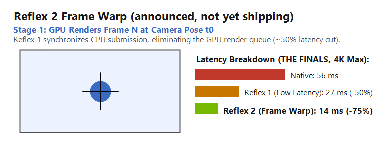

Even with an empty render queue, a complex path-traced frame still takes several milliseconds for the GPU to render, meaning the camera pose (`t0`) used at the start of GPU rendering is already slightly stale by the time the frame finishes. Reflex 2 solves this in four steps:

1. **Standard GPU Render (`t0`):** The GPU renders Frame $N$ using the camera pose known when rendering started.
2. **Late CPU Camera Calculation (`t1`):** While the GPU is busy shading Frame $N$, the CPU continues polling the mouse/controller and computes the updated camera pose `t1` for the next frame in the pipeline.
3. **Late-Stage Frame Warp:** Immediately before the finished GPU frame is sent to the display, Frame Warp samples the fresher camera pose `t1` from the CPU and geometrically warps (reprojects) the rendered image to match the player's latest aim.
4. **Predictive Inpainting:** Shifting pixels to a newer camera angle exposes small **disocclusion holes** along screen borders and behind foreground geometry where newly revealed background pixels were not visible at `t0`. NVIDIA uses a **latency-optimized predictive rendering algorithm** that draws on **camera, color, and depth data from prior frames** to inpaint those holes cleanly before scanout.

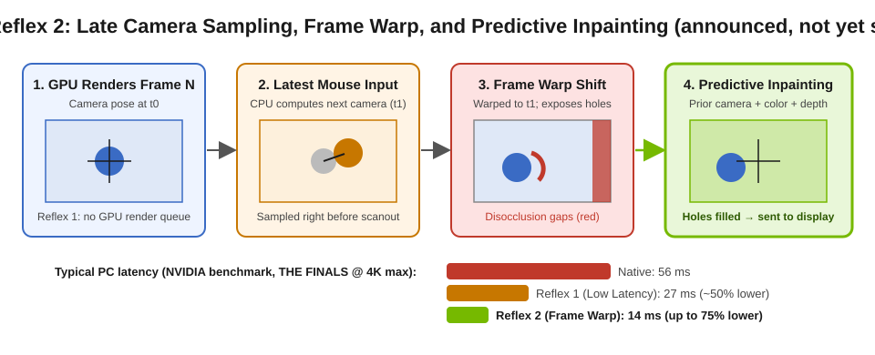

In NVIDIA's published 4K max-settings benchmark in *THE FINALS* (RTX 5070), end-to-end system latency drops from **56 ms (Native)** to **27 ms (Reflex 1)** and down to **14 ms (Reflex 2 with Frame Warp)**—and under **3 ms** at 800+ FPS in *VALORANT* on an RTX 5090. Officially, NVIDIA launched Reflex 2 support targeting **GeForce RTX 50 Series** first, with support for other GeForce RTX GPUs announced for a future update.

---

## 7. DLSS 5: 3D-Guided Neural Rendering

Announced at GTC on March 16, 2026, **DLSS 5** introduces **3D-Guided Neural Rendering**—moving DLSS beyond upscaling and frame interpolation into real-time neural shading and relighting.

Pure generative video diffusion models can synthesize photorealistic frames offline, but they are unsuitable for interactive games on their own because they hallucinate geometry, drift temporally across frames, and ignore the game engine's physics and lighting state. DLSS 5 bridges traditional raster/ray rendering and generative AI by conditioning a real-time neural renderer on the engine's structured 3D data.

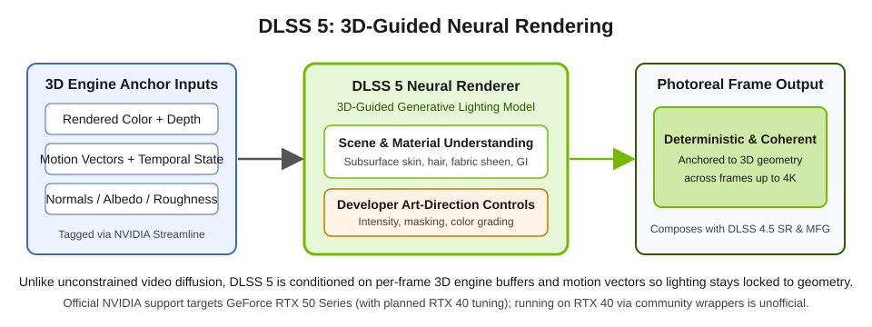

### How 3D-Guided Neural Rendering Works

- **Engine-Anchored Inputs:** Each frame, the game passes its rendered color buffer, per-pixel motion vectors, depth, carried temporal state, and surface descriptors through **NVIDIA Streamline**.
- **Semantic & Material Synthesis:** An end-to-end trained neural model (described in NVIDIA Research's DLSS 5 documentation as a one-step pixel-space generative model guided by 3D engine buffers) understands scene semantics—distinguishing translucent skin, individual hair strands, fabric weave, and environmental lighting (front-lit, back-lit, overcast). It infuses the scene with photorealistic subsurface scattering, hair sheen, and global illumination at up to 4K in real time.
- **Deterministic Art Controls:** Because the model is anchored to the underlying 3D geometry and motion vectors, lighting remains temporally stable across camera motion. Developers retain fine-grained controls via Streamline for **effect intensity, material masking, and color grading**.

*Official vs. Unofficial Hardware Support:* NVIDIA launched DLSS 5 for **GeForce RTX 50 Series** GPUs (and GeForce NOW), with official RTX 40 Series support announced as planned following additional performance tuning. Running DLSS 5 (`nvngx_dlssnr.dll` / Neural Upstream wrappers) on GeForce RTX 40 Series hardware today via community injectors is **unofficial** and not supported by NVIDIA.

---

## 8. How Game Engines Wire the Stack: NVIDIA Streamline and NGX

Game engines do not hardcode direct calls to individual neural-network weights. Instead, NVIDIA provides a two-layer architecture:

1. **NVIDIA Streamline (`sl.interposer.dll`, `sl.common.dll`, `sl.dlss.dll`, `sl.dlss_d.dll`, `sl.dlss_g.dll`, `sl.reflex.dll`):** An open-source middleware layer integrated into the engine. The game tags its render targets (color, depth, motion vectors, hudless color, UI mask) and places Reflex / PCL latency markers through a single unified API.
2. **NVIDIA NGX (`nvngx_dlss.dll`, `nvngx_dlssd.dll`, `nvngx_dlssg.dll`, `nvngx_dlssnr.dll`):** Closed-source driver and runtime libraries that manage Tensor Core execution, model weights, and preset overrides.

Across a single frame, a properly integrated engine executes these stages in strict order:

1. **Sleep & Sample Input (Reflex 1):** `slReflexSleep()` paces the CPU so input is sampled just in time before simulation begins.
2. **Jittered G-Buffer & Lighting Pass:** Render the 3D scene at internal resolution (e.g., 1080p) with sub-pixel camera jitter and export per-pixel motion vectors and depth.
3. **DLSS Super Resolution or Ray Reconstruction (Linear HDR):** Tag the noisy/low-res buffers and run `sl.dlss` (`Preset M/L/K`) or `sl.dlss_d` (`Preset F`) **before tonemapping**, producing a full-resolution (e.g., 4K) linear HDR image.
4. **Post-Processing & Hudless Snapshot:** Apply tonemapping and color grading, then tag the **hudless scene buffer**.
5. **Native-Resolution UI Pass:** Render the 2D HUD at full 4K output resolution and tag the **UI color/alpha buffer**.
6. **Frame Generation & Reflex 2 Frame Warp at Present:** Intercept `IDXGISwapChain::Present` to synthesize intermediate frames (`sl.dlss_g`), composite the crisp UI layer, apply late camera warp/inpainting if Reflex 2 is active, and pace scanout via hardware Flip Metering.

---

## 9. Why Community Injectors and Overlays Conflict

Enthusiast setups often combine **ReShade** (for HDR/shader post-processing or add-ons like `renodx-mfgunlock.addon64`), **OptiScaler** (for DLSS preset overrides, upscaler swapping, or experimental neural-rendering hooks), and **Steam Overlay** (`GameOverlayRenderer64.dll`).

All of these tools rely on **DLL proxying** and **vtable / function detouring**:

- **Single-Slot Proxy Collisions:** Windows loads `dxgi.dll`, `winmm.dll`, or `version.dll` from the game executable's folder before checking `System32`. Only one injector binary can occupy `dxgi.dll`; installing a second tool under the same filename overwrites the first.
- **Swap-Chain Wrapping & Hook Order:** Both ReShade and OptiScaler wrap `IDXGISwapChain` and detour `IDXGISwapChain::Present` and `ResizeBuffers`. If OptiScaler wraps the swap chain in a custom proxy object, external overlays like `GameOverlayRenderer64.dll` (Steam Overlay) may fail to recognize the vtable or detach shortly after injection.
- **Double Frame-Generation Collisions:** If a game natively initializes Streamline DLSS-G (`sl.dlss_g.dll`) *and* an injector simultaneously tries to inject its own frame-generation swap-chain hook, both layers fight over the present queue and hudless tags—causing instant crashes (`0xc0000374` heap corruption) or severe frame pacing stutter.

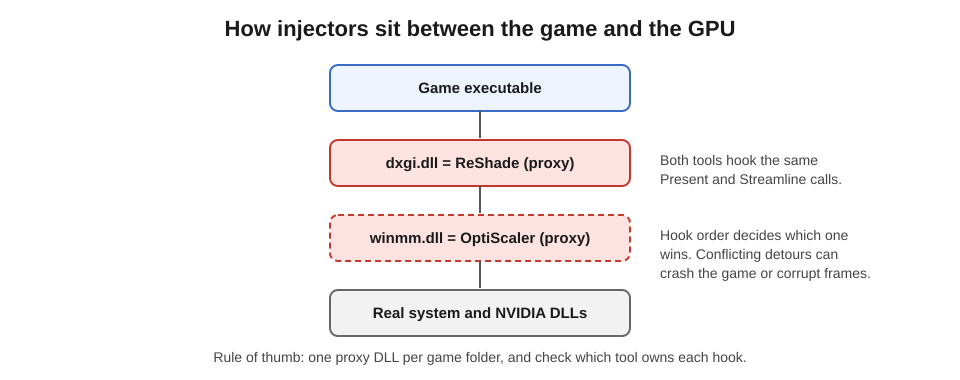

### Practical Rules for Stable Game Configurations

1. **Prefer Native DLSS-G When Available:** In titles with native Streamline DLSS-G support (such as *Cyberpunk 2077* and *Crimson Desert*), enable Frame Generation natively in the game's settings and set `FGInput = nofg` and `FGOutput = nofg` in `OptiScaler.ini` so OptiScaler manages only Super Resolution (`RenderPresetForAll = 13` for Preset M) and Ray Reconstruction (`RenderPresetForAll = 6` for Preset F).
2. **One Proxy Entry Point per Game:** Keep DLL proxy chains explicit (for example, `dxgi.dll` $\rightarrow$ ReShade and `winmm.dll` $\rightarrow$ OptiScaler) and never stack two separate frame-generation injectors in the same directory.
3. **Engine Inputs Dictate Visual Quality:** Even the newest 2nd-generation Transformer (`Preset M` / `Preset F`) cannot fix broken engine motion vectors, missing camera jitter, or a missing hudless buffer.

---

## 10. Primary Sources and References

1. **DLSS 4 & Multi Frame Generation (CES 2025):** [NVIDIA GeForce News](https://www.nvidia.com/en-us/geforce/news/dlss4-multi-frame-generation-ai-innovations/) | [NVIDIA ADLR DLSS 4 Technical Research](https://research.nvidia.com/labs/adlr/DLSS4/)
2. **DLSS 4.5 Super Resolution (2nd-Gen Transformer, Presets M/L/K) & Dynamic 6x MFG (CES 2026):** [DLSS 4.5 Announcement](https://www.nvidia.com/en-us/geforce/news/dlss-4-5-dynamic-multi-frame-gen-6x-2nd-gen-transformer-super-res/) | [DLSS 4.5 Super Resolution Available Now](https://www.nvidia.com/en-us/geforce/news/dlss-4-5-super-resolution-available-now/) | [DLSS 4.5 Dynamic MFG 6x Release](https://www.nvidia.com/en-us/geforce/news/dlss-4-5-dynamic-multi-frame-generation-6x-mode-released/)
3. **DLSS Ray Reconstruction (DLSS 3.5 & DLSS 4.5 Preset F):** [DLSS 3.5 Ray Reconstruction](https://www.nvidia.com/en-us/geforce/news/nvidia-dlss-3-5-ray-reconstruction/) | [DLSS 4.5 Ray Reconstruction Gamescom Announcement](https://www.nvidia.com/en-us/geforce/news/gamescom-2026-dlss-4-5-ray-reconstruction-release-announcements-trailers/)
4. **NVIDIA Reflex & Reflex 2 (Frame Warp & Predictive Inpainting):** [NVIDIA Reflex 2 with Frame Warp](https://www.nvidia.com/en-us/geforce/news/reflex-2-even-lower-latency-gameplay-with-frame-warp/) | [NVIDIA Reflex Developer Portal](https://developer.nvidia.com/performance-rendering-tools/reflex) | [NVIDIA Research: Post-Render Warp with Late Input Sampling](https://research.nvidia.com/publication/2020-07_post-render-warp-late-input-sampling-improves-aiming-under-high-latency)
5. **DLSS 5 (3D-Guided Neural Rendering, GTC March 2026):** [DLSS 5 Visual Fidelity Breakthrough](https://www.nvidia.com/en-us/geforce/news/dlss5-breakthrough-in-visual-fidelity-for-games/) | [NVIDIA GTC 2026 Press Release](https://investor.nvidia.com/news/press-release-details/2026/NVIDIA-DLSS-5-Delivers-AI-Powered-Breakthrough-in-Visual-Fidelity-for-Games/default.aspx) | [NVIDIA ADLR DLSS 5 Research](https://research.nvidia.com/labs/adlr/DLSS5/)
6. **NVIDIA Streamline & DLSS SDKs:** [NVIDIA Streamline GitHub Repository](https://github.com/NVIDIA-RTX/Streamline) | [NVIDIA DLSS SDK & Programming Guide](https://github.com/NVIDIA/DLSS)
